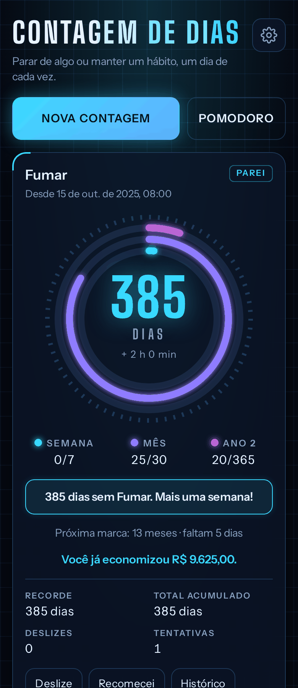
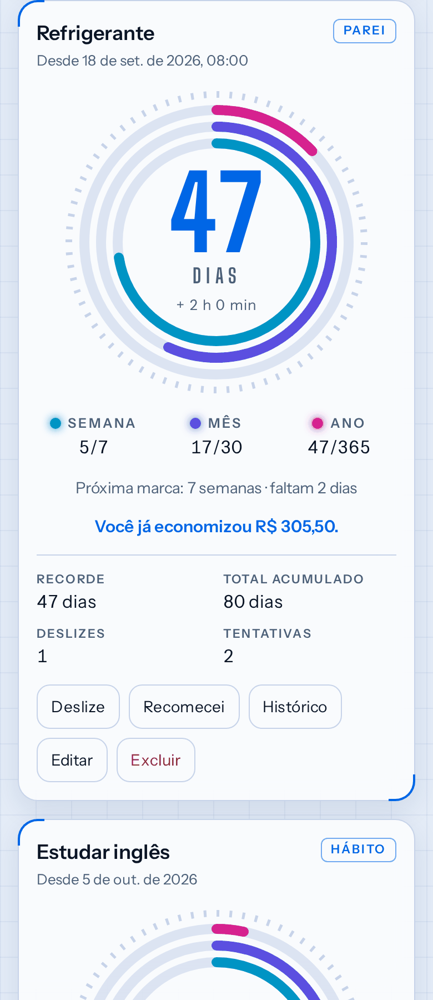
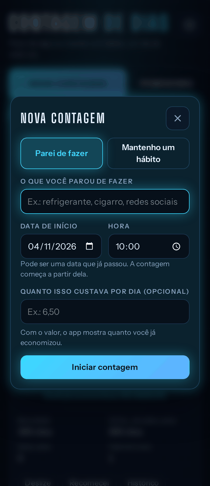
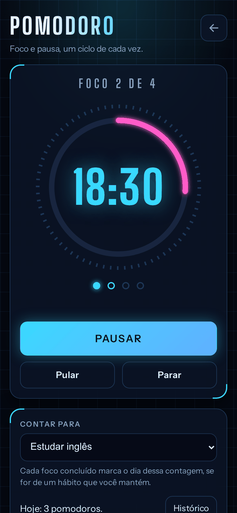
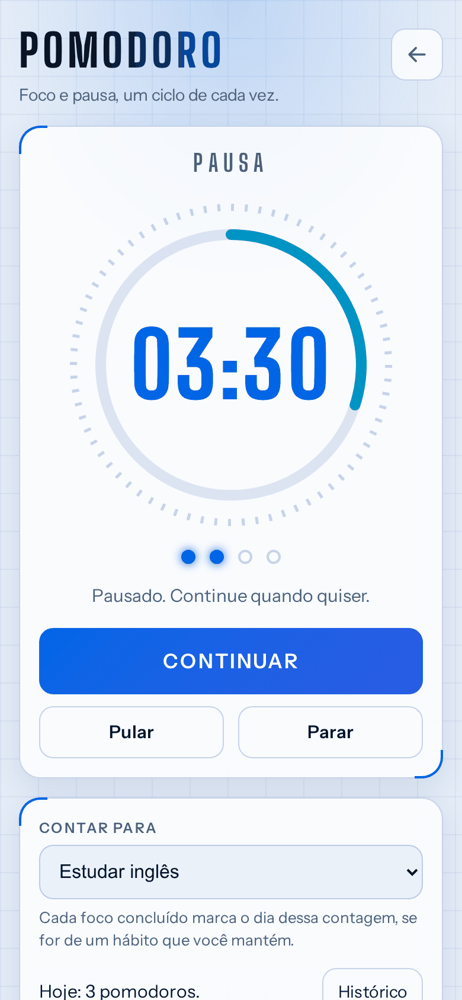
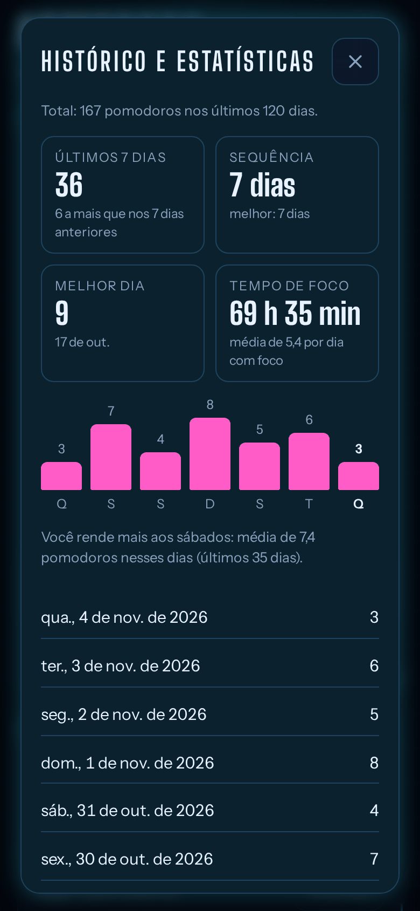
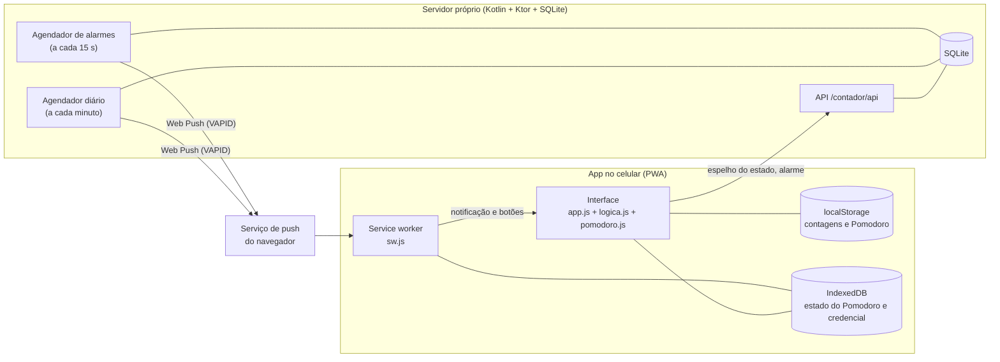

# Contador de Dias

PWA para contar há quantos dias você parou de fazer algo (ou mantém um hábito), com um Pomodoro embutido. Instala no Android pelo Chrome, funciona offline e sem login, e avisa por notificação mesmo com o app fechado.

<table>
  <tr>
    <td></td>
    <td></td>
    <td></td>
  </tr>
  <tr>
    <td></td>
    <td></td>
    <td></td>
  </tr>
</table>

As imagens são geradas com dados inventados por `python3 scripts/capturas.py`.

## O que faz

**Contagens**
- **Parar** (ex.: "refrigerante"): mostra a sequência atual, o recorde, o total de dias acumulados e as tentativas. O *deslize* não zera nada: registra o escorregão (com uma nota opcional) e segue. *Recomecei* encerra a tentativa, guarda no histórico e começa outra, no tom sem culpa.
- **Manter** (ex.: "estudar inglês"): check-in diário com um toque. A sequência conta dias seguidos; pular um dia quebra.
- **Marcos recorrentes**: semana (7 dias), mês (30) e ano (aniversário do calendário, com bissexto). Três anéis concêntricos mostram o progresso de cada ciclo, e o maior vale quando os dias coincidem.
- **Economia**: com um custo por dia, o app soma quanto você já poupou.
- Data de início no passado, tema claro, escuro ou automático, e dois visuais (futurista e clássico).

**Pomodoro** (tela própria, `#pomodoro`)
- Ciclo fixo: foco de 25 min, pausa de 5 min e, a cada quatro focos, pausa longa de 15 min. Cada fase espera o toque para começar. Pausar, Pular e Parar (que pede confirmação).
- Opcionalmente vinculado a uma contagem do tipo manter: cada foco concluído faz o check-in do dia.
- Histórico e estatísticas atrás de um botão, sem lista aberta e sem cobrança: últimos 7 dias contra os 7 anteriores, sequência de dias com foco (atual e melhor), melhor dia, tempo total de foco, barras por dia e o dia da semana em que você rende mais.
- **Com o app fechado** há uma notificação fixa com o horário do fim e botões Pausar e Parar. Quando a fase acaba, o servidor manda o aviso, com vibração, e o botão *Iniciar pausa* (ou *Iniciar foco*) já começa a fase seguinte sem abrir o app.

**Notificações**
- Um resumo por dia, no horário escolhido, com o texto de marco quando há um. Calculado no servidor.
- O cadastro é por **convite**: o administrador gera um link de uso único, e quem o abre ativa os avisos com um toque (o Android sempre pede a permissão).

## Como funciona



- **Offline primeiro.** Todo o estado vive no `localStorage` do aparelho. O app abre e funciona sem rede; o service worker responde pela rede primeiro e pelo cache como reserva.
- **Servidor só para avisar.** Quem faz a notificação diária é o servidor, então ele guarda uma cópia reduzida das contagens (sem notas nem deslizes), anônima, por aparelho: sem login, só um id e um segredo (o servidor guarda apenas o hash do segredo). Desativar apaga a cópia.
- **Web Push implementado na JVM pura**, sem biblioteca de terceiros: criptografia RFC 8291 e autenticação VAPID (RFC 8292). A biblioteca `web-push` entra só nos testes, para conferir que o resultado é idêntico.
- **Lógica duplicada de propósito, com paridade testada.** O servidor precisa montar o mesmo texto que o app. `logica.js` e `textos.js` são a referência, e `scripts/fixtures.js` gera milhares de casos (vários fusos, horário de verão, 29/02) que os testes Kotlin conferem.
- **Pomodoro com relógio por horário de fim.** O estado guarda o instante em que a fase acaba, não um contador. Recarregar a página, suspender a aba ou ficar horas fechado não bagunça o tempo. O servidor guarda um alarme por aparelho, apenas com o horário e a fase.
- **Botões da notificação.** O service worker não enxerga o `localStorage`, então o estado do Pomodoro e a credencial do aparelho são espelhados no IndexedDB (`armazem.js`). Pausar, Parar ou Iniciar pausa pela notificação alteram esse estado, a notificação e o alarme; o app aberto adota o resultado, e quem escreveu por último vale.
- **Convites.** O cadastro exige a chave de administrador ou um convite individual de uso único (20 símbolos, 7 dias, só o hash fica no servidor). O convite viaja no link depois do `#`, que o navegador não envia ao servidor, e o app o apaga do endereço assim que lê.

## Tecnologias

| Camada | O que usa |
|---|---|
| App | HTML, CSS e JavaScript puros (sem framework nem build), módulos UMD que rodam no navegador e no Node |
| PWA | Web App Manifest, Service Worker (cache de rede primeiro), Push API, Notifications API (com botões), IndexedDB, `localStorage`, Web Audio, Vibration |
| Visual | Tokens CSS, `prefers-color-scheme`, `prefers-reduced-motion`, fontes Big Shoulders Display e Instrument Sans (woff2 local, funciona offline) |
| Servidor | Kotlin 2.3, Ktor 3 (CIO), coroutines, kotlinx.serialization, SQLite (`sqlite-jdbc`, modo WAL, `secure_delete`), Maven |
| Push | Web Push com VAPID e criptografia de conteúdo (RFC 8291), implementados na JVM pura |
| Hospedagem | Celular Android com Termux (Java 21, tmux, Termux:Boot), HTTPS por Cloudflare Tunnel, no domínio próprio |
| Testes | `node:test` (unitários), Playwright com Chromium (ponta a ponta, inclusive contra o servidor real), kotlin-test e Ktor test host |

Em números: 200 testes no servidor, 184 unitários no Node, cerca de 120 verificações de interface e cerca de 120 de ponta a ponta com notificações.

## Estrutura

```
public/                 o app (servido como site estático)
  index.html            página
  app.css, app.js       estilo e interface
  textos.js             todas as frases do app, com variações
  logica.js             lógica pura (dias, marcos, economia, check-in, migração v1→v2)
  pomodoro.js           lógica pura do Pomodoro (ciclo, pausar, pular, parar, histórico, notificação fixa e botões)
  armazem.js            IndexedDB compartilhado com o service worker
  sincronia.js          notificações: inscrição no push, espelho do estado, alarme e convites
  sw.js                 service worker (cache, push, botões da notificação)
  manifest.webmanifest, icon-*.png, fonts/
servidor/               servidor Kotlin (veja servidor/README.md)
scripts/
  versao.js             sobe a versão do cache e do ?v= dos arquivos
  implantar.sh          compila, copia para o celular e reinicia
  verificar-boot.sh     confere, depois de reiniciar o celular, se o Termux:Boot subiu o servidor
  monitor.py            vigia a URL pública e avisa por e-mail quando o servidor cai e quando volta
  termux/30-contador    script do Termux:Boot (fica em ~/.termux/boot/ no celular)
  capturas.py           gera as imagens deste README
  systemd/              timers do systemd do usuário (monitor e envio gradual)
  fixtures.js, icones.py
tests/                  unitários, ponta a ponta e de versão
docs/img/               imagens do README
```

## Rodar

```bash
python3 -m http.server 8000 --directory public
```

Abra `http://localhost:8000`. O service worker funciona em `localhost`.

## Ao alterar qualquer arquivo de `public/`

Rode `node scripts/versao.js`. Ele sobe o número do cache em `public/sw.js` e o `?v=` de CSS e JS no `index.html`, para o navegador baixar tudo novo de uma vez (sem misturar HTML novo com JS antigo). Se criar um arquivo novo, inclua-o na lista `ARQUIVOS` do `sw.js`. Depois de uma atualização, o celular pode precisar de uma recarga extra para trocar o service worker antigo.

## Implantar no celular

```bash
scripts/implantar.sh            # compila, copia jar e public/ e reinicia (celular-wifi, em casa)
scripts/implantar.sh celular    # fora de casa
```

Precisa do apelido ssh configurado e do servidor já instalado em `~/contador` (veja `servidor/README.md`). O script faz build limpo, espera até 60 s o servidor subir e confere a URL pública. Antes, rode `node scripts/versao.js` se mudou algo em `public/`; o script recusa seguir com a versão fora de sincronia.

## Testes

```bash
node --test tests/*.test.js                             # unitários (Node 20+)
python3 tests/e2e.py               # ponta a ponta no Chromium (Playwright para Python)
python3 tests/e2e_push.py          # notificações: Chromium + servidor Kotlin de verdade (usa servidor/target/contador.jar)
```

O e2e cobre os dois tipos (parar e manter), deslize, recomeço, check-in, editar, excluir, ajustes, migração v1→v2, dados corrompidos, persistência e offline. Passe uma pasta como argumento para salvar capturas de tela.

O `e2e_push.py` sobe o jar com chaves VAPID temporárias e um banco temporário. Só a inscrição do navegador é simulada (o Chromium headless não fala com o FCM); o push chega ao service worker pelo CDP. Nenhum serviço de push real é contatado. Precisa do `mvn -DskipTests package` em `servidor/` antes (ele compila se o jar não existir).

## Subir sozinho depois de reiniciar o celular

`scripts/termux/30-contador` é o script do Termux:Boot. Copie para `~/.termux/boot/30-contador` no celular (`chmod 700`). Ele espera 30 s e roda `contador.sh start`, escrevendo em `~/logs/boot-contador.log`. O app Termux:Boot precisa ter sido aberto ao menos uma vez depois de instalado, e o Termux fora da otimização de bateria.

Para provar que funciona: reinicie o celular, **não abra o Termux**, espere uns 2 minutos e rode:

```bash
scripts/verificar-boot.sh            # celular-wifi; ou: scripts/verificar-boot.sh celular
```

Ele diz `BOOT OK` quando o log de boot é recente e o servidor responde.

## Monitoramento

O servidor roda num celular, então a pergunta "ele está de pé?" precisa de mais de uma resposta. Cada camada cobre uma falha diferente:

| Camada | Onde roda | Cobre | Como avisa |
|---|---|---|---|
| Laço de reinício | no celular (`contador.sh`, dentro do tmux) | o processo Java morrer | reinicia sozinho em 5 s; o log fica em `~/logs/contador.log` |
| Subir no boot | no celular (Termux:Boot, `scripts/termux/30-contador`) | o celular reiniciar | sobe o servidor sozinho; `scripts/verificar-boot.sh` prova que funcionou |
| Monitor do PC | no computador (`scripts/monitor.py`, timer do systemd, a cada 5 min) | celular desligado, sem internet, túnel caído, URL fora do ar | e-mail para várias pessoas |
| Monitor externo | serviço gratuito de monitoramento (por exemplo UptimeRobot) | tudo isso, 24 horas, mesmo com o PC desligado | e-mail da conta |
| Testes de ponta a ponta | no computador (`tests/e2e_push.py`) | regressões antes de implantar | falha o teste |

Por que duas camadas externas: o monitor do PC é meu e avisa várias caixas, mas só enquanto o computador está ligado; o serviço externo vigia sempre, mas no plano gratuito avisa só o e-mail da conta. Juntos cobrem as duas lacunas.

O que cada checagem olha: `GET /contador/api/saude` pela **URL pública**, passando pelo túnel, e não por dentro do celular. Assim ela só dá "ok" se o caminho inteiro (celular, servidor, túnel e domínio) estiver funcionando, que é o caminho que o app usa.

Alguns cuidados do monitor do PC, para o aviso valer a pena:
- Só alerta depois de **2 falhas seguidas** (10 min). Uma falha isolada de rede não vira e-mail.
- Se o próprio computador estiver sem internet, a rodada é **ignorada**: não dá para culpar o servidor.
- Alertas **não se repetem** a cada rodada: um e-mail na queda, um lembrete a cada 6 h e um aviso quando volta, com o tempo que ficou fora.
- Se o envio do e-mail falhar, o estado não conta como avisado e a próxima rodada **tenta de novo**.
- O e-mail diz **o que olhar, em ordem** (celular, `contador.sh status`, log, túnel, reinício), então dá para agir sem lembrar de nada.
- Os endereços e a senha ficam em `~/.config/contador-monitor/config.env`, **fora do git**. O repositório só tem um arquivo de exemplo.

O que o monitor ainda **não** vê: o servidor responder `ok` mas as notificações não chegarem (por exemplo, o serviço de push recusando). Para isso o servidor registra no log cada falha de envio, e o teste de ponta a ponta cobre o fluxo.

### Configurar o monitor do PC

`scripts/monitor.py` confere `/contador/api/saude` pela URL pública a cada 5 minutos e manda e-mail quando o servidor para de responder, um lembrete a cada 6 h enquanto continuar fora e um aviso quando volta. Só avisa depois de 2 falhas seguidas e ignora a rodada se o computador que vigia estiver sem internet. Usa só a biblioteca padrão do Python.

Limite: ele só vigia enquanto o computador onde roda estiver ligado. Para vigiar 24 horas, use também um serviço externo de monitoramento.

1. Copie `scripts/systemd/contador-monitor.config.exemplo` para `~/.config/contador-monitor/config.env` (`chmod 600`) e preencha os destinatários e a conta que envia. No Gmail é preciso uma *senha de app* (verificação em duas etapas ligada, em `myaccount.google.com/apppasswords`); nunca a senha normal. Esse arquivo fica fora do repositório.
2. Teste o envio: `scripts/monitor.py --testar-email`.
3. Ligue o timer:

```bash
cp scripts/systemd/contador-monitor.{service,timer} ~/.config/systemd/user/
systemctl --user daemon-reload && systemctl --user enable --now contador-monitor.timer
```

Testes: `python3 tests/monitor_test.py` (rede e e-mail simulados).
